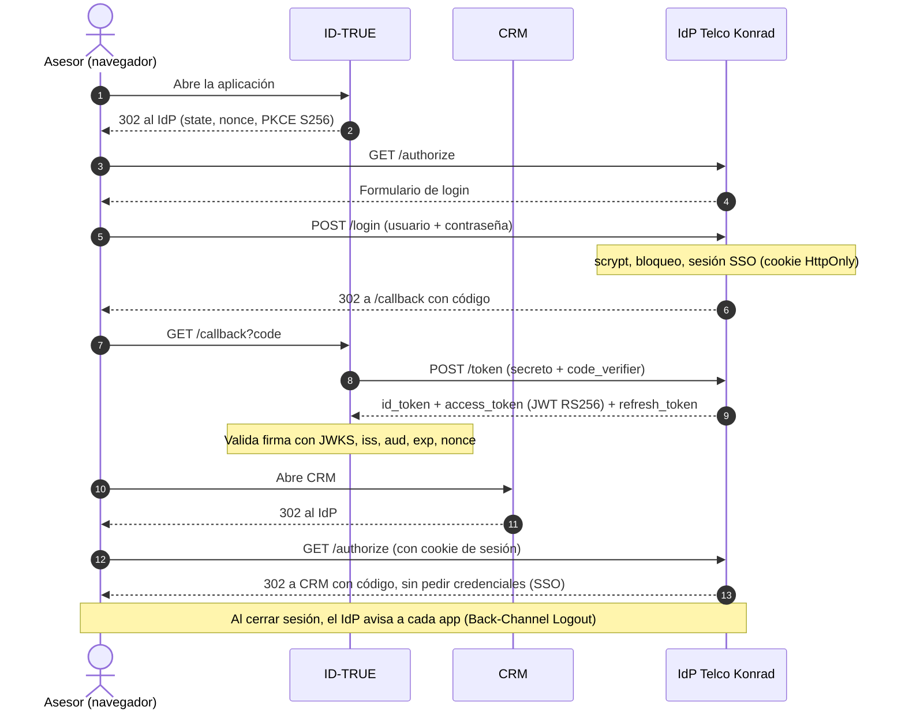

# IdP Telco Konrad · Proveedor de identidad web (SSO)

Implementación web del **proveedor de identidad (idP)** del estado TO-BE de Telco Konrad: solución #8 de la hoja 7.0 (AT-GAP-09, 10, 12 y 14). El laboratorio se limita a la **autenticación**. Las aplicaciones del inventario TO-BE existen solo como clientes del IdP y muestran **datos de prueba**.

Responde a dos puntos del anexo técnico II y a uno del TO-BE:

| Requisito | Fuente | Cómo se cumple |
|---|---|---|
| "Cada aplicación lleva a cabo su proceso de autenticación… establecer un mecanismo de SSO" | Anexo técnico II, punto 1 | Las 9 aplicaciones delegan el login en el IdP con **OpenID Connect**. Una sola sesión sirve para todas, y el cierre de sesión es global. |
| "El almacenamiento de la contraseña se debe llevar a cabo bajo algún algoritmo de encripción" | Anexo técnico II, punto 2 | Contraseñas con **scrypt** (N=16384, sal única de 16 bytes por usuario). Las aplicaciones ya no guardan contraseñas. |
| "Adjuntar mediante un acceso seguro, personal e intransferible los documentos faltantes" | TO-BE, recepción de documentos | El cliente abre un **enlace de un solo uso**, escribe su documento y valida un **código OTP** enviado a su correo. Solo ve su expediente. |

## Cómo ejecutarlo

Requisito: **Node.js 20 o superior**. No hay dependencias que instalar.

```powershell
cd IdP_Telco_Konrad
npm start
```

Abre cualquier aplicación, por ejemplo **ID-TRUE** en http://localhost:4001. Para correr las pruebas automáticas (19 casos):

```powershell
npm test
```

Si los puertos 4000-4090 están ocupados: `$env:BASE_PORT=5000; npm start`.

| Componente | URL | Acceso |
|---|---|---|
| **IdP · Telco Konrad ID** | http://localhost:4000 | — |
| ID-TRUE | http://localhost:4001 | Asesor, back de validación |
| CRM | http://localhost:4002 | Asesor, back de validación, analista de crédito, auditor |
| Validación Crediticia | http://localhost:4003 | Asesor, analista de crédito |
| RequestManager | http://localhost:4004 | Asesor, analista de crédito |
| DOCUMENTO DIGITAL | http://localhost:4005 | Asesor |
| Gestor Documental | http://localhost:4006 | Gestión documental, auditor |
| Listas Negativas | http://localhost:4007 | Fraude, back de validación |
| Portal de carga del cliente | http://localhost:4008 | Cliente (OTP) |
| Consola del IdP | http://localhost:4009 | Administrador IdP, auditor (solo lectura) |
| Buzón de correo (simulado) | http://localhost:4090 | Aquí llegan los OTP y los enlaces |

## Usuarios de prueba

Son personas ficticias. Las contraseñas solo aparecen en texto plano en [`idp/datos-prueba.js`](idp/datos-prueba.js), que sirve para generar el directorio. Al arrancar, el IdP crea `idp/data/usuarios.json` **solo con los hashes**.

| Usuario | Contraseña | Rol | Para probar |
|---|---|---|---|
| `camila.rojas` | `Asesor#2026` | ROLE_ASESOR | SSO entre ID-TRUE, CRM, Validación, RequestManager y DOCUMENTO DIGITAL |
| `andres.molina` | `Back#2026` | ROLE_BACK_VALIDACION | ID-TRUE y Listas Negativas |
| `laura.gomez` | `Fraude#2026` | ROLE_FRAUDE | Listas Negativas |
| `diana.castro` | `Credito#2026` | ROLE_ANALISTA_CREDITO | Validación Crediticia y RequestManager |
| `mario.ruiz` | `Archivo#2026` | ROLE_GESTION_DOCUMENTAL | Gestor Documental |
| `sofia.herrera` | `Auditor#2026` | ROLE_AUDITOR | CRM, Gestor y consola en solo lectura |
| `admin.idp` | `Admin#2026` | ROLE_ADMIN_IDP | Consola: revocar sesiones y desbloquear cuentas |
| `pedro.lopez` | `Retirado#2026` | (inactivo) | Una cuenta desactivada no entra |

Cliente remoto (sin contraseña): **CC 1032456789**, Juan Pérez Gómez. El enlace lo envía la asesora desde DOCUMENTO DIGITAL.

## Guion de demostración (≈ 6 min)

1. **Login único.** Abre http://localhost:4001 (ID-TRUE). La aplicación te lleva al IdP. Entra como `camila.rojas`.
2. **SSO.** En el panel "Otras aplicaciones" pulsa **CRM** y luego **RequestManager**: entran sin pedir la contraseña. RequestManager muestra los datos del cliente leídos de la **API del CRM** con el *access token* de Camila (llamada 200).
3. **Autorización.** Pulsa **Listas Negativas**: Camila está autenticada pero su rol no la autoriza, así que aparece **403**. 401 significa "¿quién eres?"; 403 significa "no puedes".
4. **Cliente remoto con OTP.** En **DOCUMENTO DIGITAL** pulsa "Enviar enlace de carga" en SOL-2026-0412. Abre el [buzón](http://localhost:4090), haz clic en "Abrir enlace", escribe `CC 1032456789` y el código que llega al buzón. El cliente ve **solo su expediente**. Si escribes otro documento (`52123456`), el IdP lo rechaza porque el enlace es intransferible.
5. **Bloqueo.** En otra ventana privada escribe 5 veces una contraseña errada para `diana.castro`. La sexta vez, incluso con la clave correcta, la cuenta sigue bloqueada.
6. **Gobierno central.** Entra a la **Consola del IdP** como `admin.idp`. Allí ves las sesiones activas y las aplicaciones de cada una, el bloqueo de Diana (puedes desbloquearla) y la bitácora. Si pulsas **Revocar** en una sesión, ese usuario queda fuera de todas las aplicaciones.
7. **Logout global.** En cualquier aplicación pulsa **Cerrar sesión**. Si luego abres otra aplicación, el IdP pide credenciales de nuevo.

## Arquitectura



| Carpeta | Contenido |
|---|---|
| [`idp/`](idp/) | Servidor del IdP ([`server.js`](idp/server.js)), directorio con scrypt ([`directorio.js`](idp/directorio.js)), bitácora y datos de prueba |
| [`apps/`](apps/) | Plantilla de cliente OIDC ([`app-oidc.js`](apps/app-oidc.js)) y pantallas con datos de prueba de cada aplicación ([`catalogo.js`](apps/catalogo.js)) |
| [`lib/`](lib/) | JWT RS256 y JWKS, utilidades HTTP, plantillas HTML y buzón simulado |
| [`test/`](test/) | Pruebas de extremo a extremo con un navegador simulado |
| [`config.js`](config.js) | Puertos y registro de aplicaciones (clientes OIDC) |

### Endpoints del IdP

| Endpoint | Para qué |
|---|---|
| `GET /.well-known/openid-configuration` | Descubrimiento OIDC |
| `GET /jwks.json` | Llave pública para validar los tokens |
| `GET /authorize` | Inicio del flujo Authorization Code + PKCE |
| `POST /login` | Login de empleados (usuario + contraseña) |
| `POST /otp/enviar`, `POST /otp/verificar` | Login de clientes (documento + código OTP) |
| `POST /token` | Canje del código y renovación con refresh token |
| `GET /userinfo` | Perfil del usuario autenticado |
| `GET/POST /logout` | Cierre de sesión global (RP-Initiated + Back-Channel Logout) |
| `/admin/api/*` | Sesiones, bloqueos, bitácora y directorio (requiere ROLE_ADMIN_IDP o ROLE_AUDITOR) |

### Controles de seguridad

| Control | Dónde |
|---|---|
| PKCE S256 obligatorio; el código sirve una vez y vence en 60 s; si se canjea dos veces, se revocan los tokens emitidos con él | `/authorize`, `/token` |
| `redirect_uri` exacto y registrado; si no coincide, no se redirige (evita *open redirect*) | `/authorize` |
| Tokens JWT firmados con RS256; *access token* de 5 min | IdP y apps |
| Refresh token con rotación; si se reutiliza uno ya rotado, se revoca toda la familia | `/token` |
| Contraseñas con scrypt y sal única; tiempo constante con usuarios inexistentes | `directorio.js` |
| Mismo mensaje para contraseña errada, usuario inactivo o usuario inexistente (no permite enumerar cuentas) | `/login` |
| Bloqueo de 15 min tras 5 intentos fallidos | `/login` |
| OTP de 6 dígitos, 5 min, 3 intentos, guardado como hash; enlace de carga de un solo uso y ligado al documento | `/otp/*`, portal |
| Cookies HttpOnly + SameSite=Lax; nueva sesión en cada login (evita fijación de sesión) | IdP y apps |
| `state` ligado al navegador (evita CSRF de login), CSRF en todos los formularios, `nonce` en el ID token | apps e IdP |
| Cabeceras CSP, X-Frame-Options, no-store; las páginas no usan JavaScript | `lib/http.js` |
| Bitácora de cada evento de autenticación (`idp/data/auditoria.log`) | `auditoria.js` |

## Alcance y diferencias con producción

- **Producto.** La matriz (hoja 5.0) propone **Keycloak**. Este IdP usa los mismos estándares (OIDC, PKCE, JWKS, Back-Channel Logout), así que las aplicaciones se podrían conectar a Keycloak cambiando solo la URL del emisor y los secretos de [`config.js`](config.js).
- **Estado en memoria.** Las sesiones, los códigos y los bloqueos se pierden al reiniciar, y la llave de firma se genera en cada arranque. En producción irían en una base de datos o caché y la llave en un HSM o almacén de secretos.
- **HTTP local.** Corre en `http://localhost`. En producción va detrás de TLS (AT-GAP-15) y las cookies llevan `Secure` (`COOKIE_SECURE=1`).
- **Correo simulado.** El buzón en memoria reemplaza al servidor SMTP (Microsoft 365, integración I10).
- **Aplicaciones de prueba.** Las 9 aplicaciones muestran datos fijos. La carga de archivos del portal también es simulada.
- **Siguiente paso natural.** Agregar un segundo factor (TOTP) para los roles privilegiados (`ROLE_ADMIN_IDP`, `ROLE_FRAUDE`).
