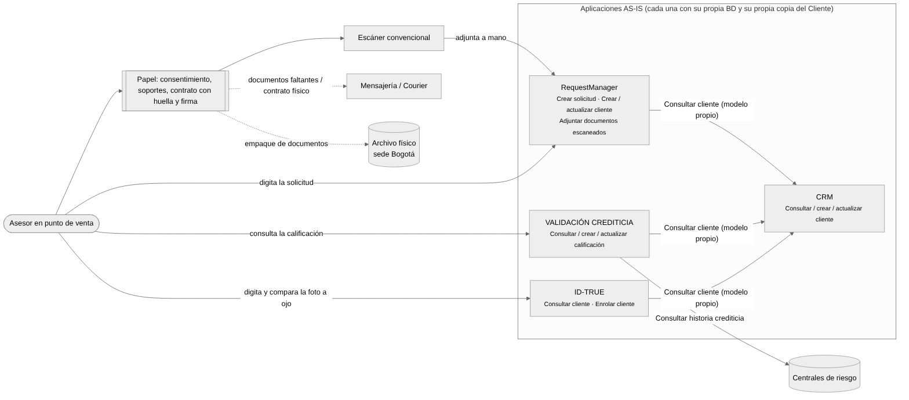
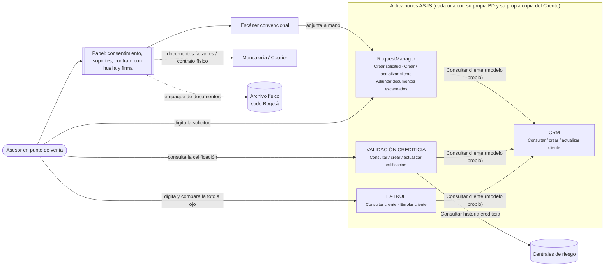
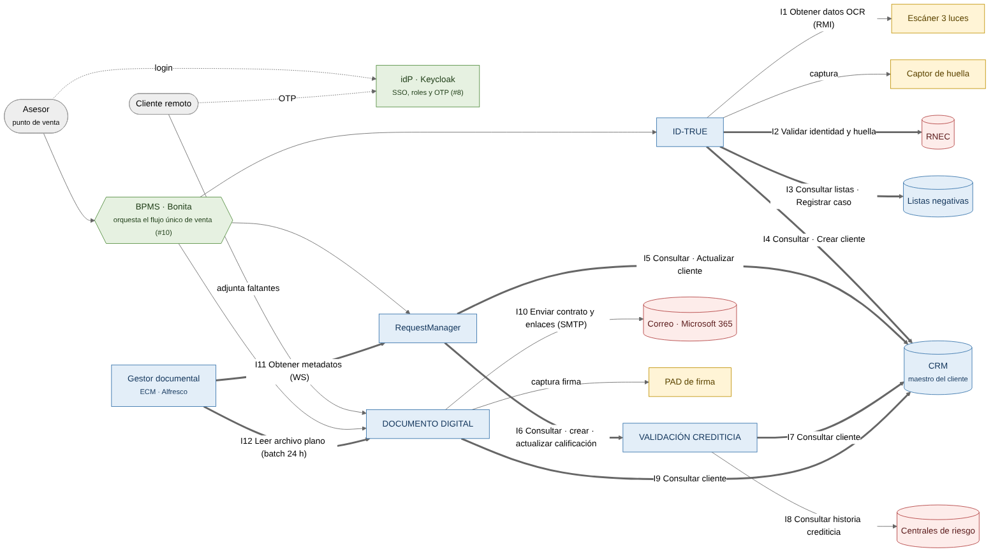
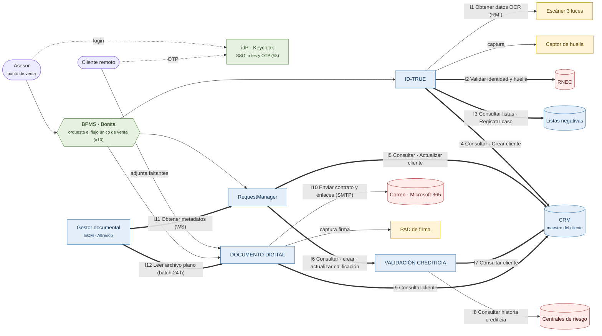
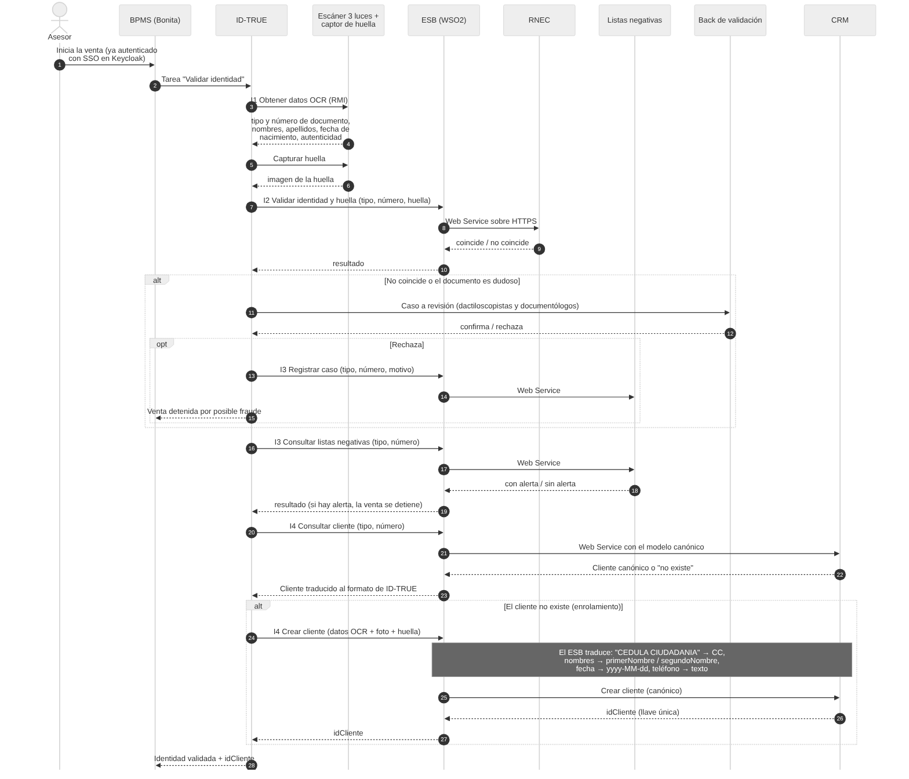
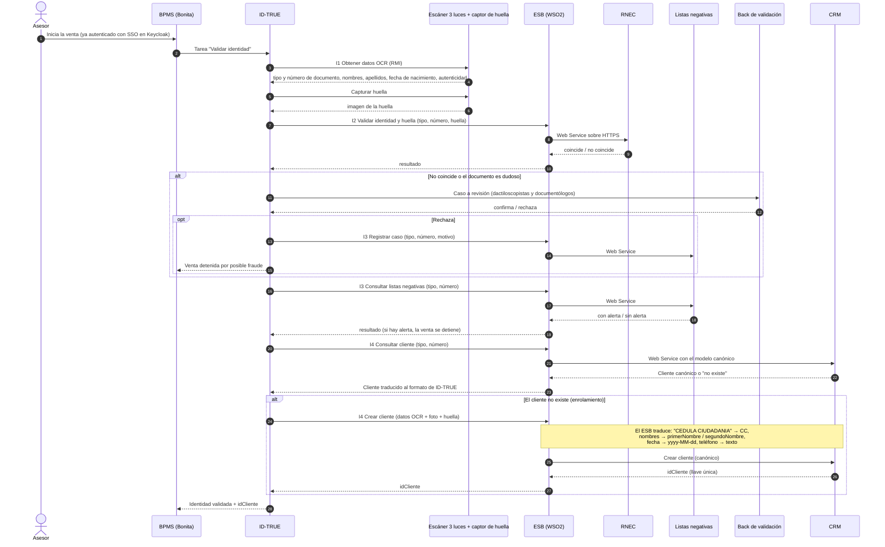
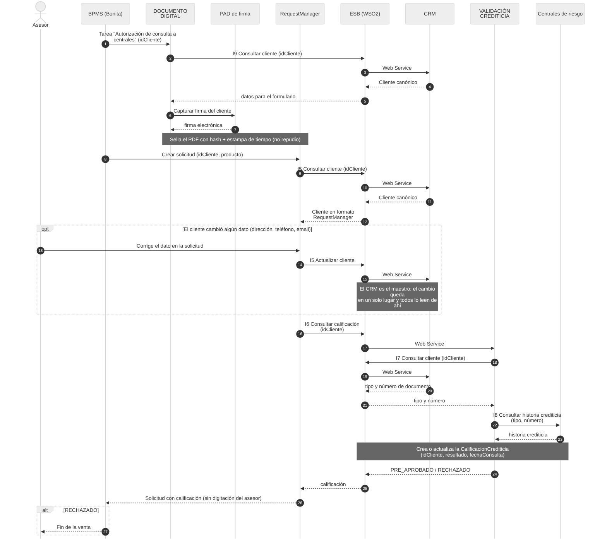
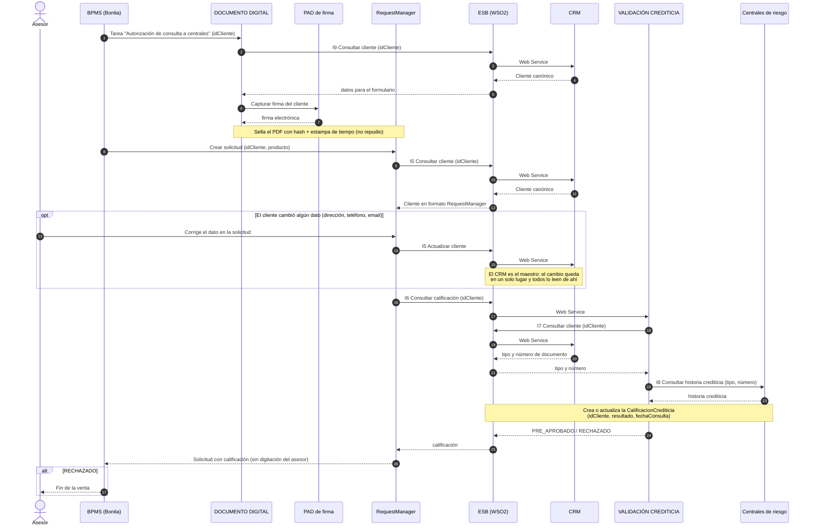
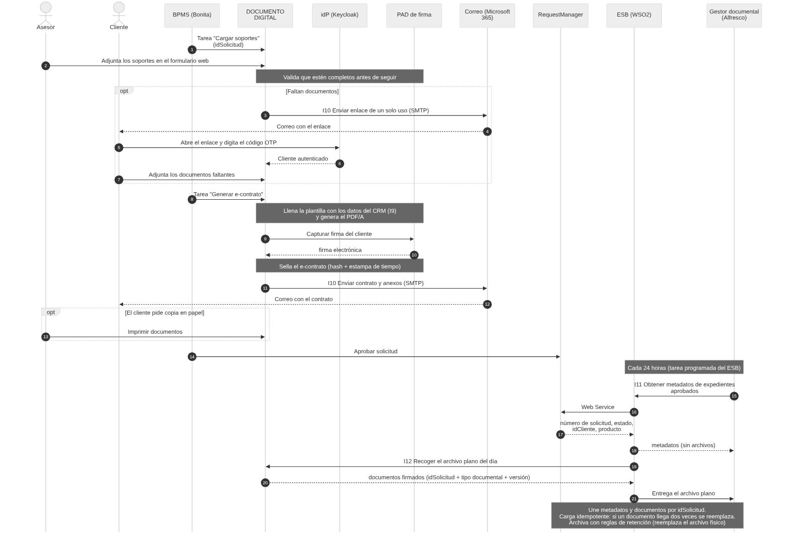
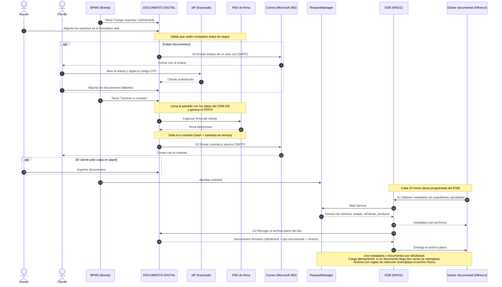

# Integraciones TO-BE · Telco Konrad

Cómo se comunican las aplicaciones, con qué método y qué dato viaja en cada llamada. Complementa las hojas 4.0 (integración), 5.0 (tecnología) y 7.0 (soluciones) de la matriz EA-XPress del Taller 8.

Cada diagrama aparece dos veces: como **código Mermaid** (GitHub y VS Code lo dibujan, y se edita como texto) y como **imagen PNG** en esta misma carpeta, por si el visor no soporta Mermaid.

---

## 1. Cómo leer los diagramas

| Elemento | Significado |
|---|---|
| **I1 … I12** | Número de integración; está detallada en la tabla de la sección 4 |
| Línea gruesa (`==>`) | Web Service que **pasa por el ESB** (WSO2 Micro Integrator): el ESB traduce al modelo canónico, enruta y cifra con TLS |
| Línea delgada (`-->`) | Conexión **directa**, sin ESB (RMI con el escáner, SMTP con el correo, consulta a centrales de riesgo, dispositivos) |
| Línea punteada (`-.->`) | Autenticación con el idP (login SSO del asesor u OTP del cliente) |
| Flecha `A → B` | **A consume** un servicio que **expone B** (igual que en la hoja 4.0: fila consume a columna) |
| En los diagramas de secuencia: flecha continua / punteada | Petición / respuesta |
| `#n` | Número de la solución en la hoja 7.0 (ABB-ID) |

Colores del mapa TO-BE: azul = aplicaciones, verde = orquestación y seguridad, amarillo = dispositivos del punto de venta, rojo = sistemas externos.

---

## 2. AS-IS: cómo es hoy

**Problemas que se ven en el diagrama:**
- **Tres aplicaciones consultan el cliente en el CRM, cada una con su propio modelo de datos.** El cliente queda replicado en cuatro bases (AINF-GAP-01 a 04).
- **El papel une los procesos:** consentimiento y contrato firmados a mano, escaneados y adjuntados uno por uno, mensajería para los faltantes y archivo físico en Bogotá.
- **La identidad se valida comparando la foto a ojo:** de ahí vienen los fraudes que reporta el AS-IS.

---

## 3. TO-BE: mapa general

**Ideas clave:**
1. **El CRM es el centro del dato:** cuatro aplicaciones leen el cliente de un único servicio (I4, I5, I7, I9) y solo ID-TRUE (crear) y RequestManager (actualizar) lo modifican.
2. **El BPMS no transporta datos:** ordena los pasos (tareas) y llama a las aplicaciones. El ESB es quien lleva cada dato de una aplicación a otra.
3. **El gestor documental recibe por dos vías que no se pisan:** metadatos desde RequestManager (I11) y documentos desde DOCUMENTO DIGITAL (I12).
4. **Keycloak autentica a todos:** asesores con SSO y clientes remotos con OTP.

---

## 4. Tabla de integraciones

| # | Consume → Expone | Método (inventario del anexo) | Medio | Viaja de ida | Viaja de vuelta | GAP | Solución |
|---|---|---|---|---|---|---|---|
| I1 | ID-TRUE → Escáner 3 luces | Obtener datos OCR | RMI, directo | Orden de lectura del documento | Tipo y número de documento, nombres, apellidos, fecha de nacimiento y resultado de autenticidad | AINT-GAP-06 | #7 |
| I2 | ID-TRUE → RNEC | Validar identidad y huella | WS HTTPS vía ESB | Tipo y número de documento + imagen de la huella | Coincide / no coincide | AINT-GAP-05 | #7 |
| I3 | ID-TRUE → Listas negativas | Consultar listas negativas · Registrar caso | WS vía ESB | Tipo y número (y el motivo, al registrar) | Con alerta / sin alerta | AINT-GAP-07 | #3 |
| I4 | ID-TRUE → CRM | Consultar cliente · Crear cliente | WS vía ESB (canónico) | Tipo y número; al crear: datos OCR, foto y huella | Cliente canónico o "no existe"; al crear: **idCliente** | AINT-GAP-01 | #9 |
| I5 | RequestManager → CRM | Consultar cliente · Actualizar cliente | WS vía ESB (canónico) | idCliente; al actualizar: dirección, teléfono o email | Cliente canónico / confirmación | AINT-GAP-03 | #9 |
| I6 | RequestManager → Validación Crediticia | Consultar / crear / actualizar calificación | WS vía ESB | idCliente | PRE_APROBADO / RECHAZADO | AINT-GAP-04 | #10 |
| I7 | Validación Crediticia → CRM | Consultar cliente | WS vía ESB (canónico) | idCliente | Tipo y número de documento | AINT-GAP-02 | #9 |
| I8 | Validación Crediticia → Centrales de riesgo | Consultar historia crediticia | Directo (se mantiene del AS-IS) | Tipo y número | Historia crediticia | KEEP | — |
| I9 | DOCUMENTO DIGITAL → CRM | Consultar cliente | WS vía ESB (canónico) | idCliente | Datos para formularios y e-contrato | AINT-GAP-08 | #9 |
| I10 | DOCUMENTO DIGITAL → Correo (Microsoft 365) | Enviar contrato y anexos · Enviar enlace de carga | SMTP, directo | Email del cliente + PDF del contrato, o enlace de un solo uso | Confirmación de envío | AINT-GAP-09 | #2 |
| I11 | Gestor documental → RequestManager | Obtener metadatos del expediente aprobado | WS vía ESB, cada 24 h | Fecha de corte | Número de solicitud, estado, idCliente y producto (**sin archivos**) | AINT-GAP-10 | #9 |
| I12 | Gestor documental → DOCUMENTO DIGITAL | Leer archivo plano | Batch 24 h (tarea programada del ESB) | — | Documentos firmados con idSolicitud, tipo documental y versión | AINT-GAP-11 | #9 |

**Fuera de la tabla (no son integraciones entre aplicaciones):**
- ID-TRUE ↔ captor de huella y DOCUMENTO DIGITAL ↔ PAD de firma: son dispositivos del punto de venta (#7 y #11).
- BPMS → ID-TRUE, RequestManager y DOCUMENTO DIGITAL: tareas del flujo único (#10).
- Asesor y cliente → Keycloak: autenticación (#8).

---

## 5. Recorrido de una venta, paso a paso

### 5.1 Validación de identidad y enrolamiento

### 5.2 Autorización de centrales, solicitud y calificación

### 5.3 Documentos, e-contrato, envío y archivo

---

## 6. Qué traduce el ESB: el Cliente en cada sistema vs. el canónico

El ESB recibe el formato de cada aplicación y lo convierte al modelo canónico de la hoja 2.1 antes de llegar al CRM (y al revés en la respuesta).

| Canónico (hoja 2.1) | ID-TRUE | CRM (antes) | RequestManager | Regla de traducción |
|---|---|---|---|---|
| idCliente (BIGINT) | — | — | — | Lo asigna el CRM al crear; todos lo usan como llave |
| tipoDocumento (CC, TI, CE, PT) | TipoDocumento "CEDULA CIUDADANIA"… | Tipo_Documento CC… | — (no lo guarda) | "CEDULA CIUDADANIA" → CC, "TARJETA IDENTIDAD" → TI, "CEDULA EXTRANJERIA" → CE, "PASAPORTE" → PT |
| numeroDocumento (texto) | NumeroIdentificacion INT | Numero_Identificacion INT | Identificacion VARCHAR(30) | Número → texto, sin puntos ni espacios |
| primerNombre / segundoNombre | Nombres (un solo campo) | Primer_Nombre / Segundo_Nombre | Nombre1 / Nombre2 | ID-TRUE: se parte por el primer espacio |
| primerApellido / segundoApellido | Apellidos (un solo campo) | Primer_Apellido / Segundo_Apellido | Apellido1 / Apellido2 | Igual que los nombres |
| fechaNacimiento (yyyy-MM-dd) | FechaNacimiento DATE(10) | FechaNacimiento dd/MM/yy | — | dd/MM/yy → yyyy-MM-dd |
| telefono (texto con indicativo) | Telefono INT | Telefono VARCHAR | — | Número → texto, agrega +57 |
| estadoCivil (1 a 6) | Texto "SOLTERO"… | 1 a 6 | — | Texto → código del catálogo |
| nivelEscolaridad (1 a 4) | Texto "PRIMARIA"… | 1 a 4 | — | Texto → código del catálogo |
| email | — | — | Email | Pasa igual; es el único canal de envío del contrato |
| rutaFoto / plantillaHuella / rutaFirma | Foto / huella capturada | Foto | — | Nuevos en el canónico; los guarda el CRM |

**Calificación (Validación Crediticia):** antes guardaba tipo + número + BOOLEAN. En el canónico guarda idCliente + resultado (PRE_APROBADO / RECHAZADO) + fechaConsulta (AINF-GAP-03).

---

## 7. Cómo editar

- **Diagramas:** se edita el bloque `mermaid` de este archivo. Para regenerar las imágenes: `npx @mermaid-js/mermaid-cli -i archivo.mmd -o archivo.png` (copiando el bloque a un `.mmd`), o se exporta desde [mermaid.live](https://mermaid.live).
- Si cambia una integración, hay que actualizar también la hoja 4.0 y la tabla de la sección 4.
